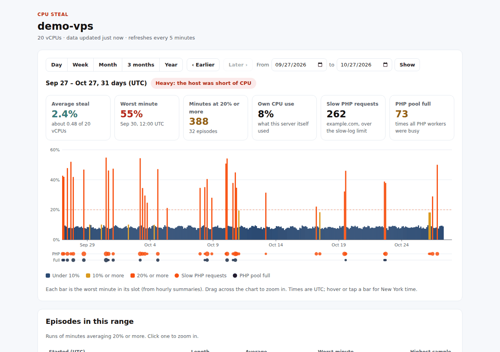
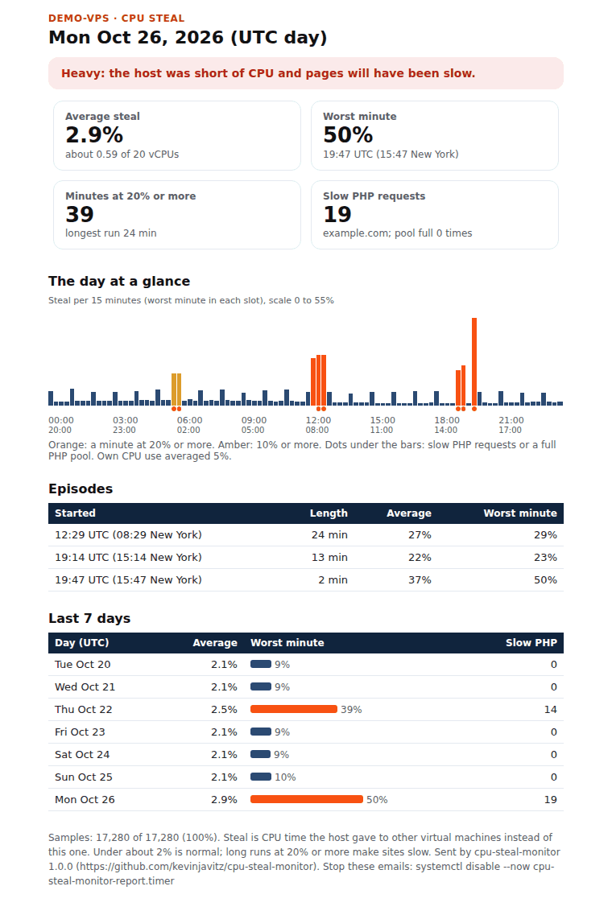

# cpu-steal-monitor

Find out whether your VPS is slow because of **your** server or because of **your host**.

CPU steal is CPU time the hypervisor hands to other virtual machines on the same physical host while yours is waiting
to run. On a crowded host, a quiet server with plenty of free CPU still serves pages slowly, and nothing in `top`
explains why. This tool measures steal every 5 seconds and gives you:

- a **daily email** with a verdict (Low / Watch / Heavy), the day's chart, the worst episodes and a 7-day trend;
- a **web dashboard** to look back over days, weeks and months, with drag-to-zoom;
- a **"Ticket for your web host"** text with the exact times and numbers, ready to paste into a support ticket;
- optional **PHP-FPM signals** (slow requests and "pool full" warnings) on the same timeline, so you can see whether
  slow pages line up with steal spikes.

It is one Python file using only the standard library (Python 3.9+), plus a static HTML dashboard. There is no
database, no agent to sign up for and no open port.



<details>
<summary>The daily email</summary>



</details>

## Install

On the VPS, as root:

```sh
git clone https://github.com/kevinjavitz/cpu-steal-monitor.git
cd cpu-steal-monitor
sudo ./install.sh
```

Setup asks a few questions; press Enter to skip any of them:

1. **Email for the daily report** (leave empty for no email), what time to send it, and the From address. It uses the
   server's `sendmail` if there is one, or an SMTP server you name.
2. **An extra time zone** to show next to UTC (for example `America/New_York`).
3. **A dashboard folder** inside a website (for example `/var/www/html/cpu-steal`) and its address, and whether to
   protect it with a password (recommended).
4. **PHP-FPM logs** (optional): the slow log and the error log, and which pool to count. Common paths are suggested.

Then it starts the sampler, imports any `sar` history the server already has (sysstat keeps about a month), builds
the dashboard and can send a test email. Your first full daily report arrives the morning after.

Requirements: Linux with systemd, Python 3.9 or newer, and a full virtual machine (KVM, Xen, VMware, Hyper-V).
Containers (OpenVZ, LXC, Docker) usually report 0% steal, so the numbers mean little there.

### Without questions

Every answer has a flag, so it can run from a script:

```sh
sudo ./install.sh --yes \
  --email you@example.com --report-time 07:00 --mail-from "CPU steal <monitor@example.com>" \
  --tz America/New_York --tz-label "New York" \
  --web-dir /var/www/html/cpu-steal --web-url https://example.com/cpu-steal/ \
  --web-user admin --web-password-file /root/dash-pass.txt \
  --php-slowlog '/var/log/php-fpm/*slow.log' --php-fpm-log /var/log/php-fpm/error.log \
  --site-label example.com --test-email
```

Other flags: `--no-email`, `--no-web`, `--no-web-password`, `--php-pool NAME`, `--host-label NAME`, `--sendmail PATH`,
`--smtp-host HOST --smtp-port 587 --smtp-security starttls|ssl|none --smtp-user U --smtp-password P`.
Run `cpu-steal-monitor setup` again at any time to change answers; it keeps the dashboard login unless you give a new one.

## Reading the numbers

Steal is shown as a percentage of all your vCPUs. 10% on an 8-vCPU server means about 0.8 of a CPU was missing.

| Verdict | When |
|---|---|
| **Low** | Average under 3% and no minute at 20% or more |
| **Watch** | Average 3% or more, or any minute at 20% or more |
| **Heavy** | Average 10% or more, or 5 or more minutes in a row at 20% or more |

A steady 1-2% is normal on shared hosts. Short runs at 20% or more are what make pages slow; a 10-minute average
(what `sar` keeps) hides most of them, which is why this samples every 5 seconds. An **episode** is a run of minutes
averaging 20% or more (change it with `EPISODE_PCT`).

**Own CPU use** is what your server itself used in the same time. Low own use plus high steal points at the host. High
own use plus slow pages points at your server.

## Commands

```
cpu-steal-monitor status              what is running and the latest numbers
cpu-steal-monitor report --stdout     yesterday's report as text (--day YYYY-MM-DD, --hours N)
cpu-steal-monitor report --to ADDR    send the report now
cpu-steal-monitor ticket --hours 24   support-ticket text (--day, --since/--until in UTC)
cpu-steal-monitor update --all        rebuild the dashboard data
cpu-steal-monitor import-sar          import past history from sysstat
cpu-steal-monitor setup               change the answers
```

## Dashboard

The dashboard is a static page plus JSON files, rewritten every 5 minutes. Setup writes an `.htaccess` with basic
auth for Apache and LiteSpeed (the password file is `/etc/cpu-steal-monitor.htpasswd`). On **nginx**, setup prints a
`location` block to add yourself:

```nginx
location /cpu-steal/ {
    auth_basic "CPU steal monitor";
    auth_basic_user_file /etc/cpu-steal-monitor.htpasswd;
    add_header Cache-Control "private, no-store";
}
```

If the site is behind a caching CDN (Cloudflare and the like), check that the folder is not cached: open it in a
private window and make sure it still asks for the password.

No web server? Skip the dashboard and use the email, or copy the folder to your own computer and open it with
`python3 -m http.server` inside it.

## What it costs the server

Measured on an 8-vCPU KVM VPS: about 80 µs of CPU per sample, roughly 1.4 seconds of CPU per day for the sampler,
about 9 MB of memory and about 350 KB of disk per day. The systemd units cap it at 64 MB of memory and 10% of one
CPU.

## Files

| Path | What |
|---|---|
| `/opt/cpu-steal-monitor/` | the program and dashboard template |
| `/etc/cpu-steal-monitor.conf` | settings (`KEY=value`, mode 600) |
| `/var/lib/cpu-steal-monitor/` | data: 5-second samples (kept 35 days), 1-minute rollups and PHP events (kept 400 days) |
| `/usr/local/bin/cpu-steal-monitor` | the command |
| `cpu-steal-monitor.service` | the sampler |
| `cpu-steal-monitor-update.timer` | dashboard data, every 5 minutes |
| `cpu-steal-monitor-report.timer` | the daily email |

Other settings in the config file: `EPISODE_PCT` (20), `RAW_DAYS` (35), `KEEP_DAYS` (400).

## Uninstall

```sh
sudo /opt/cpu-steal-monitor/uninstall.sh           # remove the services, program and dashboard; keep data and config
sudo /opt/cpu-steal-monitor/uninstall.sh --purge   # also delete the data and the config
```

To stop only the emails: `sudo systemctl disable --now cpu-steal-monitor-report.timer`.

## Licence

MIT. See [LICENSE](LICENSE).
